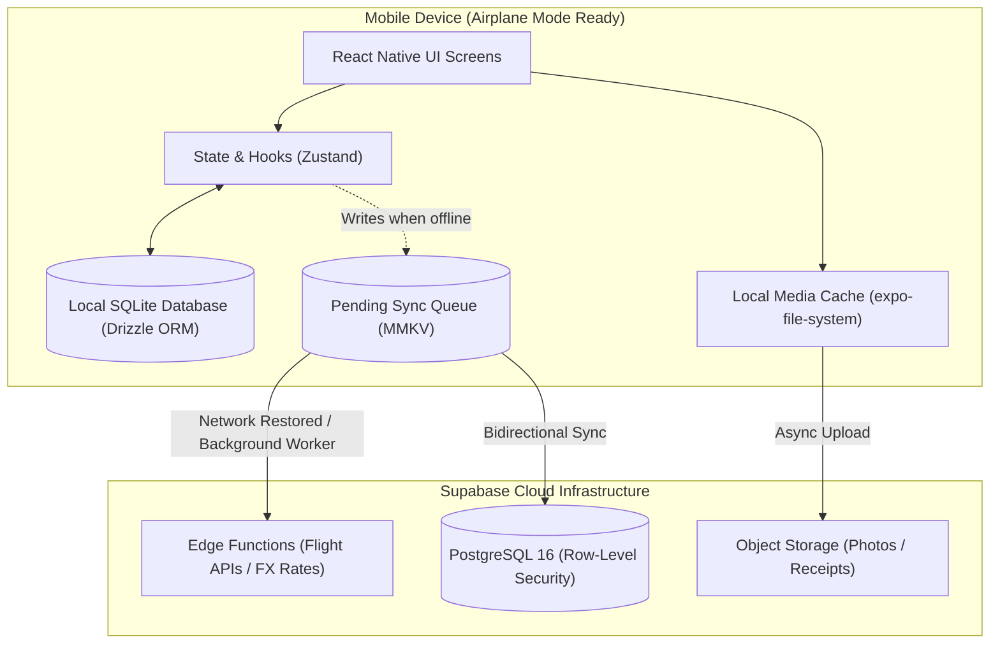
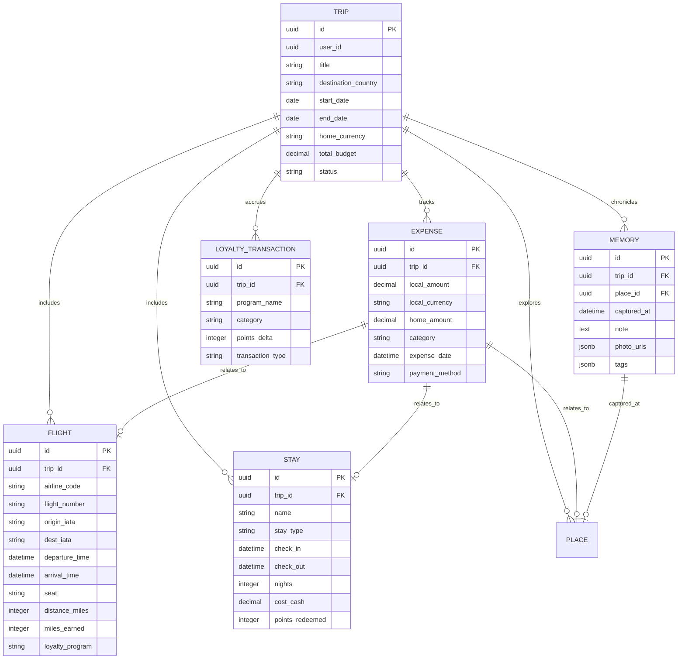
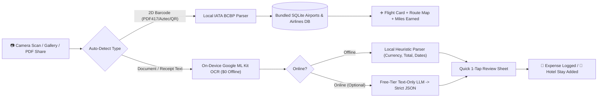
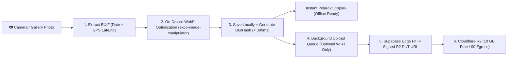

# WanderLedger: Mobile App Architecture & Technical Blueprint

## 1. Product Vision & Core Value Proposition

**WanderLedger** is an all-in-one mobile companion designed to solve the fragmentation of modern travel apps. Travelers currently juggle 4–6 disconnected tools:
* Flighty / TripIt for flight status
* Booking.com / Airbnb for accommodation info
* Splitwise / TrabeePocket for expenses & currency conversion
* AwardWallet / Excel sheets for airline miles & loyalty points
* Apple Photos / Polarsteps for memories and journals

WanderLedger fuses the **Logistical Ledger** (flights, stays, multi-currency expenses, points earned) with the **Emotional Story** (interactive itinerary, geotagged memories, food logs, and trip recap cards).

---

## 2. Recommended Mobile Technology Stack

### ⭐ Top Recommendation: React Native + Expo (TypeScript) + Supabase

```
+-------------------------------------------------------------+
|                     WanderLedger Mobile App                 |
|             (React Native 0.76+ / Expo SDK 52)              |
+-------------------------------------------------------------+
| UI Framework: Expo Router v3 (File-based navigation)        |
| Styling: NativeWind (Tailwind CSS for React Native)         |
| Maps & Geo: @maplibre/maplibre-react-native / expo-location |
| Gestures & Animation: react-native-reanimated + gesture-handler
+-------------------------------------------------------------+
                              |
       +----------------------+----------------------+
       |                                             |
[Local-First Offline Storage]               [Cloud Backend & Sync]
* expo-sqlite with Drizzle ORM              * Supabase (PostgreSQL 16)
  (Relational offline DB)                   * Supabase Auth (Apple / Google)
* react-native-mmkv                         * Supabase Storage (CDN + WebP)
  (Instant cached rates, active trip state) * Edge Functions (Deno / TS)
* expo-file-system + BlurHash               * Realtime sync engine
  (Local image caching & lazy uploads)
```

### Stack Comparison Matrix

| Dimension | React Native + Expo (Recommended) | Flutter | Native (SwiftUI + Jetpack Compose) |
| :--- | :--- | :--- | :--- |
| **Time to Market** | ⚡ Very Fast (single shared TS codebase) | ⚡ Fast (single Dart codebase) | 🐢 Slow (2 independent codebases) |
| **Offline-First Support** | 🌟 Excellent (`expo-sqlite` + Drizzle/Watermelon) | 🌟 Excellent (Drift / Isar) | 🌟 Excellent (SwiftData / Room) |
| **Ecosystem for Travel** | Vast (MapLibre, BlurHash, Currency formatters) | Good (google_maps_flutter, hive) | Best native performance |
| **Team / Code Reusability** | 90%+ code shared between iOS & Android + Web | 90%+ code shared | 0% code shared |
| **Maintenance Cost** | Low (single team, shared types with backend) | Medium (separate Dart tooling) | High (dual platform engineers) |

### Why This Stack Excels for Travel:
1. **Zero-Lag Offline Resilience**: When boarding a plane or landing in a subway without a SIM card, the app operates 100% locally from SQLite.
2. **Instant Camera & Media Optimization**: `expo-camera` and `expo-image` automatically generate BlurHash placeholders so the feed loads instantly without network lag.
3. **Cross-Platform Parity**: Polished fluid animations, bottom sheets, and native map rendering across both iOS and Android.

---

## 3. Offline-First Sync & Storage Architecture



### Offline Strategy Principles:
1. **Optimistic Local Writes**: Creating an expense, adding a flight, or writing a journal note commits immediately to local SQLite in `< 10ms`.
2. **Sync Queue Engine**: Every mutation records a change vector (`mutation_id`, `entity`, `action`, `payload`, `timestamp`). When online, mutations flush via idempotent edge endpoints.
3. **Daily Cached Exchange Rates**: 160+ fiat currencies are cached locally on app launch. Offline expenses instantly convert to home currency without network requests.

---

## 4. Comprehensive Database Schema (PostgreSQL & SQLite)

### Core Entities:
* **Trips**: The parent container (title, destination countries, start/end dates, base currency, budget).
* **Flights**: Flight number, airline, origin/destination IATA codes, departure/arrival timestamps, seat, terminal, flight miles earned, loyalty program.
* **Stays**: Hotel/Airbnb name, address, coordinates, check-in/out, nights, total cost, points redeemed vs cash.
* **Places Visited**: Geotagged spots (restaurants, museums, viewpoints, cafes) with rating and personal notes.
* **Expenses**: Multi-currency ledger (amount, local currency, converted home currency, category, payment method, linked flight/stay/place).
* **Loyalty Ledger**: Points/miles earned or redeemed per airline/hotel program, status qualifier tracking.
* **Memories**: Diary logs, captions, photo URLs, local media URIs, timestamps, mood tags.



---

## 5. Third-Party APIs & External Integrations

| Service | Purpose | Fallback / Free Alternative |
| :--- | :--- | :--- |
| **AeroDataBox / FlightAware API** | Auto-populates airline, aircraft, route distance, scheduled departure/arrival times from flight number | Offline static IATA/ICAO airport coordinates database for distance calculation |
| **Open Exchange Rates / Frankfurter** | Daily FX rate updates for 160+ currencies | Free Frankfurter API (ECB rates) cached locally in SQLite |
| **MapLibre GL / OpenStreetMap** | Offline vector tiles and route rendering with flight geodesic arcs | Mapbox SDK (if custom aesthetic vector styles are preferred) |
| **Apple Wallet / Google Wallet** | Import `.pkpass` files directly for instant flight & hotel boarding import | In-app QR / Barcode camera scanner |

---

## 6. Zero-Cost Architecture (Optimized for ~100 Users + Play Store)

Since you already have a **Google Play Developer account**, you can build, deploy, and operate WanderLedger for **\$0/month**:

| Layer | Zero-Cost Choice | Free Quota (More than enough for ~100 users) |
| :--- | :--- | :--- |
| **App Framework** | **React Native + Expo (Custom Dev Build / Prebuild)** | \$0 (Build Android `.aab` locally or via EAS Free Tier: 30 builds/mo) |
| **Primary Database** | **`expo-sqlite` (Local-First on Device)** | \$0, unlimited, instant offline reads/writes |
| **Cloud Backup / Sync** | **Option A: Google Drive AppData Backup** *(user's own Drive)*<br>**Option B: Supabase Free + Cloudflare R2** | **Option A:** \$0 forever at any scale (no server maintenance!)<br>**Option B:** 500 MB Postgres + 50k MAUs Auth + 10 GB R2 photo storage (\$0 egress) |
| **Boarding Pass Scan** | **On-device 2D Barcode (`PDF417`/`Aztec`/`QR`) + Local IATA BCBP Parser** | \$0, 100% offline, 100% deterministic |
| **Flight Details & Miles** | **Bundled Public Airport/Airline SQLite DB (OpenFlights/OurAirports)** | \$0, offline Haversine miles, airport names, cities, timezones, map arcs |
| **Receipt & Hotel OCR** | **Google ML Kit On-Device Text Recognition** | \$0, runs locally on Android/iOS, works offline, no API limits |
| **Smart Receipt Structuring** | **Offline Heuristic/Regex Parser + Optional Gemini 2.5 Flash-Lite Free Tier (text-only)** | \$0 (Free tier covers ~1,000+ text parses/day; fallback to offline regex when no signal) |
| **Currency Conversion** | **Frankfurter API (ECB Rates) cached daily in SQLite** | \$0 forever |

---

## 7. Camera-Based Smart Capture Pipeline



### Why This Scanner Design Is Ideal for Travel:
1. **Boarding Passes (Zero Errors, Zero API Cost)**: Every airline boarding pass encodes passenger name, PNR, origin/destination IATA, carrier, flight number, Julian date, cabin class, seat, and frequent flyer number inside a standard **IATA BCBP** barcode. Decoding happens in `< 5ms` offline.
2. **Instant Flight Enrichment (Hybrid Offline + Online Flight API)**:
   * **Step A (Instant Offline Baseline)**: Cross-referencing the decoded IATA codes against a bundled ~1.5 MB SQLite table of 7,000+ global airports and 1,000+ airlines immediately renders full city names, exact Haversine distance in miles, estimated duration, timezone offset, and the geodesic flight arc on the World Map.
   * **Step B (Online Live Enrichment via Supabase Edge Function)**: When online, the app calls `POST /enrich-flight` (`carrier`, `flight_number`, `date`). The Edge Function first checks a shared **`flight_cache` table in Postgres** (30-min TTL for upcoming/live flights; permanent cache for past flights) so co-travelers or repeated views never burn duplicate API credits. On a cache miss, it queries a free-tier Flight API (e.g., **AirLabs** 1,000 free req/mo or **AeroDataBox** via adapter pattern) to pull **exact scheduled/actual departure & arrival times, terminal, gate, aircraft model (e.g., Boeing 787-9), and live status**. If offline or quota-exhausted, it gracefully keeps the offline baseline without errors.
3. **Receipts & Hotel Confirmations**: Running **Google ML Kit OCR** on-device keeps raw images private and fast (works in underground restaurants or foreign countries with roaming turned off). Only lightweight extracted text (~150 words) is optionally passed to a free-tier LLM for multilingual normalization (e.g., Japanese, Korean, Thai, or European receipts) into structured JSON.

---

## 7B. Photo & Receipt Processing and Storage Pipeline

To deliver crisp Polaroid memories that load instantly offline while keeping 100+ users comfortably inside **Cloudflare R2's 10 GB Free Tier (\$0 egress)**:



### Optimization & Privacy Rules:
* **Memory Photos (20x Size Reduction)**: Raw 5 MB phone photos are never uploaded directly. Before upload, the phone generates:
  * **Display WebP** (`max 1600px`, 80% quality → **~180–250 KB**) — sharp on all mobile displays & shared web postcards.
  * **Thumbnail WebP** (`400px`, 70% quality → **~25 KB**) + a **25-byte BlurHash string** stored directly in SQLite/Postgres for zero-flicker gallery scrolling.
  * **EXIF GPS & Timestamp Harvest**: Captures original photo date/coordinates before compression so photos auto-file into the right Trip Day and plot pins on the World Map.
* **Scanned Receipts (Ultra-Compact & Strictly Private)**:
  * Resized to `max 1200px` high-contrast grayscale WebP → **~60–90 KB** per receipt.
  * Stored under a separate private prefix (`receipts/{trip_id}/{user_id}/{id}.webp`) that requires authenticated trip-member authorization and is **never accessible via read-only public Postcard links**.
* **Storage Capacity Math (100 Users)**: At ~220 KB per memory photo, **10 GB free on Cloudflare R2 stores ~45,000 vacation photos** (450+ photos per user) at **\$0/month** and **\$0 bandwidth** even when family members view shared Postcard links.
* **Roaming-Friendly Uploads**: A user setting (*"Sync full photos on Wi-Fi only"*) defaults to ON while keeping metadata/receipts syncing immediately over cellular.

---

## 8. Phased Development Roadmap

### Phase 1: MVP, Offline Ledger & Smart Scanner (Weeks 1–3)
* Project scaffolding with Expo SDK (TypeScript + NativeWind) configured for Android builds.
* SQLite schema setup (`expo-sqlite` + Drizzle ORM) + bundled OpenFlights Airport/Airline database.
* **Smart Camera Scanner v1**:
  * Boarding pass barcode scanner (IATA BCBP parser -> auto-creates Flight + Distance + Miles).
  * Receipt/Hotel OCR capture (ML Kit on-device text extraction -> auto-fills Expense or Stay review sheet).
* Multi-currency expense ledger with daily cached Frankfurter FX rates.

### Phase 2: Memories & Interactive Journey Timeline (Weeks 4–6)
* Visual day-by-day itinerary feed (chronological stream of flights, stays, places, meals, and photos).
* Camera capture & photo album integration with local disk compression (WebP) and BlurHash preview.
* Places visited bookmarking with GPS reverse-geocoding.
* Interactive trip map showing flight arcs and location pins.

### Phase 3: Loyalty Vault & Financial Analytics (Weeks 7–9)
* Loyalty program manager (Frequent Flyer miles, hotel points, credit card rewards).
* "Value Per Point" (CPP) calculator for award redemptions vs cash bookings.
* Visual expense breakdown charts by category (Dining, Transit, Accommodation, Activities, Shopping).

### Phase 4: Zero-Cost Cloud Backup & Play Store Launch (Weeks 10–12)
* Cloud sync/backup (Google Drive AppData or Supabase Free + Cloudflare R2).
* Shareable "Trip Wrapped" summary cards.
* Android `.aab` build & Google Play Store internal/closed testing track rollout to your first 100 users.
