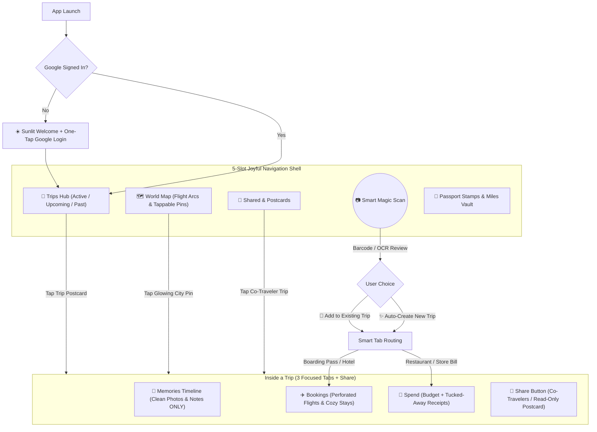

# WanderLedger — Joyful Travelogue UX & Design System Blueprint

## 1. Visual Identity: "Sunlit Postcard & Passport Journal"

Instead of feeling like an expense spreadsheet or corporate tracker, WanderLedger is designed to **put a smile on the traveler's face** every time they open it:

* **Warm Paper Canvas**: Sunlit cream background (`#FFF9F2`) with crisp white postcard cards and soft amber borders.
* **Cheerful Travel Palette**: Sunset Coral (`#F97316` / `#F43F5E`), Ocean Sky (`#0EA5E9`), Matcha Emerald (`#10B981`), and Passport Navy (`#1E1B4B`).
* **Tactile Storytelling Elements**:
  * **Scenic Illustrated Trip Covers** (Mount Fuji sunrise, Amalfi coast, Lisbon rooftops, Alpine snow) or the user's own favorite cover photo.
  * **Polaroid Memory Cards** with slight playful tilt, masking-tape accents, and happy mood stickers (`🌅 Core Memory`, `🍜 Yum!`, `🏔️ Adventure`).
  * **Perforated Vintage Boarding Passes** with scalloped ticket notches.
  * **Rotated Rubber Ink Stamps** in the digital Passport book for every country visited.
* **Friendly Micro-Copy**: *"Ready to wander, Alex? ✨"*, *"Kyoto is treating you well!"*, *"You've flown 1.7x around the Earth 🌍"*.

---

## 2. Navigation Architecture (Balanced 5-Slot Bottom Bar)

---

## 3. Finalized UX Product Decisions

### 1. World Map Tab (`🗺️`)
* Displays a stylized, cheerful world map with **animated dashed flight arcs** connecting airports and **glowing destination pins**.
* Tapping any pin pops open a **mini postcard** with dates, favorite quote/note, miles flown, and a 1-tap **"Open Trip →"** button.
* Celebrates fun cumulative milestones (e.g., *"1.7x around the Earth • 14 Countries • 29 Cities"*).

### 2. Smart Camera Scan: User Always Chooses Trip Destination (`📷`)
* After decoding a boarding pass (offline IATA BCBP) or scanning a hotel confirmation / restaurant bill (on-device ML Kit OCR), the 1-tap confirmation sheet gives the user a clear choice:
  * **`📎 Add to Existing Trip`** (pre-selects the trip whose dates match, with a dropdown to switch).
  * **`✨ Auto-Create New Trip`** (pre-fills destination & dates right from the scanned boarding pass or hotel booking).

### 3. Clean Separation: Polaroid Memories vs. Tucked-Away Receipts
* **`📸 Memories` Tab (Timeline)**: Strictly reserved for **photos, Polaroid stories, places visited, and mood notes**. Zero receipt clutter!
* **`🧾 Spend` Tab (Ledger)**: Safely tucks away all scanned **receipts and bills** alongside multi-currency totals and category charts. Tapping any spend item lets the user peek at the attached receipt image or itemized scan.

### 4. Shareable Trips & Postcards (`💌`)
* **Co-Traveler Collaboration**: Invite partners or friends (via Google login) to join a trip so everyone can drop their own photos, boarding passes, and shared expenses into one unified travelogue.
* **Read-Only Postcard Link**: Generate a shareable link showing the **Memories Timeline + Route Map** for family/friends back home — **automatically hiding private spend & receipts**.

---

## 4. Architecture Implication (Why Storage Decision Is Now Crystal Clear)

Because trips are **shareable** (co-travelers editing a shared trip + read-only web postcard links) while staying **\$0/month** for ~100 users, the clear winning backend architecture is:

* **Google Sign-In + Supabase Free Tier** (PostgreSQL with Row-Level Security for personal + shared trip memberships, 500 MB DB, 50k MAUs — **\$0/mo**).
* **Local-First `expo-sqlite`** on Android so the app remains 100% instant & usable offline in airplane mode, syncing seamlessly to Supabase when online.
* **Cloudflare R2 Free Tier** (10 GB free compressed WebP photo & receipt storage + **\$0 egress** — handles ~40,000 vacation photos for free!).
